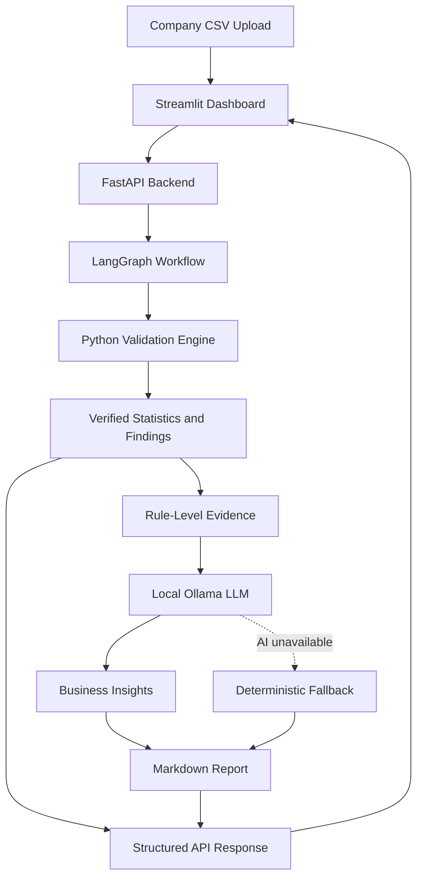

# Business Data Quality Intelligence

An AI-assisted data quality analysis application that identifies potential issues in company datasets, groups validation findings into actionable evidence, and generates business-oriented insights using a locally hosted language model.

## Overview

Business datasets may contain missing values, duplicate company records, invalid fields, and unusual numerical values. These issues can affect downstream reporting and analytical decisions.

This project combines deterministic Python validation with a local LLM to help users investigate potential data quality risks through an interactive dashboard.

## Key Features

- **Rule-based validation:** Detects missing values, potential duplicate companies, invalid country codes, negative revenue, invalid employee counts, invalid credit scores, unusual annual growth, and invalid website formats.
- **Evidence-based analysis:** Groups validation findings by rule and includes example records for investigation.
- **AI-assisted insights:** Uses Ollama with Llama 3.2 to generate business-oriented explanations and recommendations.
- **Fallback reporting:** Generates a deterministic report if local AI insight generation fails.
- **REST API:** FastAPI endpoints for health checks, CSV uploads, validation, and report retrieval.
- **Interactive dashboard:** Streamlit interface with KPI cards, charts, filters, searchable findings, and downloadable reports.
- **Automated tests:** Tests for validation, agent behavior, API responses, and AI fallback handling.

## Technology Stack

- Python
- Pandas
- LangGraph
- Ollama — Llama 3.2
- FastAPI
- Streamlit
- Requests
- Unittest

## Architecture



The Python validation engine is the source of truth for validation statistics. The LLM explains the supplied evidence but does not independently verify the underlying company data.

## Project Structure

```text
ai-data-quality/
├── data/
│   └── companies.csv
├── reports/
├── src/
│   ├── agent.py
│   ├── ai_report.py
│   ├── api.py
│   ├── dashboard.py
│   ├── validation.py
│   ├── test_agent.py
│   ├── test_api.py
│   └── test_validation.py
└── test_ollama.py
```

## Getting Started

### Prerequisites

- Python 3.12 or a compatible Python version
- Ollama installed locally
- Git

### 1. Clone the repository

```bash
git clone <YOUR_GITHUB_REPOSITORY_URL>
cd ai-data-quality
```

### 2. Create and activate a virtual environment

Windows PowerShell:

```powershell
python -m venv .venv
.\.venv\Scripts\Activate.ps1
```

### 3. Install dependencies

Install the project's dependencies from the requirements file once it has been created:

```powershell
pip install -r requirements.txt
```

### 4. Set up the local language model

```powershell
ollama pull llama3.2
```

Ensure Ollama is running and the model is available:

```powershell
ollama list
```

### 5. Start the API

```powershell
uvicorn src.api:app --reload
```

API documentation is available at:

`http://127.0.0.1:8000/docs`

### 6. Start the dashboard

Open a second terminal, activate the virtual environment, and run:

```powershell
streamlit run src/dashboard.py
```

Open the local Streamlit URL shown in the terminal.

## Running the Tests

From the project root:

```powershell
python -m unittest discover -s src -p "test_*.py" -v
```

The current development version has passed 11 automated tests covering validation, successful AI responses, AI fallback behavior, and API request handling.

## API Endpoints

| Method | Endpoint | Purpose |
|---|---|---|
| GET | `/health` | Check backend health |
| POST | `/run-validation` | Run validation on the default dataset |
| POST | `/upload-csv` | Upload and analyze a CSV |
| GET | `/report` | Retrieve the generated Markdown report |

## Validation and AI Design

The application separates deterministic checks from language-model output:

1. Python validates the dataset against configured rules.
2. Findings are grouped into rule-level evidence.
3. Ollama generates a business-oriented explanation.
4. If AI generation fails, the workflow creates a fallback report.
5. The report combines verified Python statistics with the generated narrative.

Validation findings are potential issues, not necessarily confirmed errors. Human review is required before modifying source records.

## Current Limitations

- The included dataset is intended for demonstration and is not a production company database.
- Validation depends on the implemented rules and configured thresholds.
- LLM-generated explanations may be incomplete or generic.
- The current workflow uses a sequential LangGraph pipeline rather than a multi-agent architecture.
- The prototype stores a shared generated report file, which can be overwritten by subsequent runs.
- Production deployment would require additional security, observability, access controls, and scalable report storage.

## Future Enhancements

- Add configurable validation rules and business-specific thresholds.
- Improve the traceability of recommendations to individual findings.
- Add data-quality trend analysis and report history.
- Introduce structured AI output validation and more edge-case tests.
- Add containerization and CI/CD.
- Evaluate performance on larger datasets.

## Disclaimer

This project is an educational prototype for data quality analysis. It does not independently verify company information, guarantee the correctness of source records, or replace human review.
